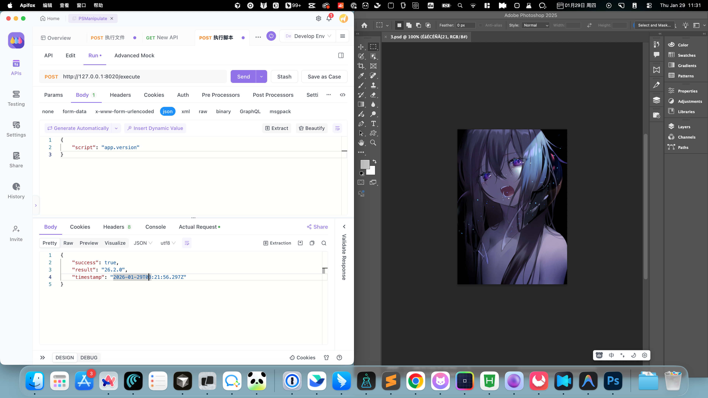

# Photoshop Manipulate Bridge

[](LICENSE)

**简体中文** | [English](README.md)

---

Photoshop Generator 插件，**在 Photoshop 内启动 HTTP 服务**。外部程序可通过 HTTP/WebSocket 与 Photoshop 通信并控制 Ps——自动化任务、执行 JSX、获取文档信息等。



## 功能说明

- **作为 Generator 插件运行在 Photoshop 内**
- **在 Photoshop 启动时启动 HTTP 服务**（默认端口 **8020**）
- **提供 HTTP + WebSocket API**，任意外部工具（脚本、应用、命令行）可：
  - 在 Photoshop 中执行 JSX
  - 获取文档/图层信息
  - 触发动作并接收事件
  - 从命令行或其他应用控制 Photoshop

可用于构建自动化、集成或由自有软件远程控制 Ps。

## 前置条件

- **Node.js 18+**
- **Adobe Photoshop CC** 或更高版本，并已启用 **Generator**  
  （偏好设置 → 插件 → 勾选「启用 Generator」，然后重启 Photoshop）

## 快速开始

### 1. 安装插件

**方式一：使用发布版安装包（推荐）**

- **macOS**：运行 `release/photoshop-manipulate-bridge-*.pkg`  
  安装到：`/Library/Application Support/Adobe/Plug-Ins/CC/Generator/photoshop-manipulate-bridge`
- **Windows**：运行 `release/PhotoshopManipulateBridge-Setup-*.exe`  
  安装到：`%COMMONPROGRAMFILES%\Adobe\Plug-Ins\CC\Generator\photoshop-manipulate-bridge`

**方式二：从源码构建**

```bash
npm install
npm run build
```

然后将 `dist/` 文件夹（以名称 `photoshop-manipulate-bridge`）复制到：

- **macOS**：`~/Library/Application Support/Adobe/Adobe Photoshop [版本]/Plug-ins/Generator/`
- **Windows**：`%COMMONPROGRAMFILES%\Adobe\Plug-Ins\CC\Generator\`

### 2. 启用 Generator 并重启 Photoshop

偏好设置 → 插件 → 勾选 **启用 Generator** → 重启 Photoshop。

### 3. 使用 HTTP API

Photoshop 加载插件并运行后，服务在 **http://localhost:8020** 可用。

```bash
# 查看服务状态
curl http://localhost:8020/status

# 执行 JSX（例如弹出提示）
curl -X POST http://localhost:8020/execute \
  -H "Content-Type: application/json" \
  -d '{"script": "alert(\"来自 HTTP 的问候\");"}'
```

在浏览器打开 **http://localhost:8020** 可访问简易 Web 控制台。

## API 概览

| 接口       | URL / 协议           | 用途                     |
|------------|----------------------|--------------------------|
| **HTTP**   | `http://localhost:8020` | 任意客户端的 REST 调用   |
| **WebSocket** | `ws://localhost:8020` | 实时双向通信             |

### HTTP 端点

| 方法   | 路径       | 说明           |
|--------|------------|----------------|
| GET    | `/`        | Web 控制台     |
| GET    | `/status`  | 服务状态       |
| POST   | `/execute` | 执行 JSX 或动作（JSON 请求体） |

### WebSocket 消息

- `ping` – 测试连接  
- `alert` – 在 Photoshop 中显示提示  
- `executeJSX` – 执行 JSX 脚本  
- `getDocumentInfo` – 获取文档信息  

示例客户端（HTTP、WebSocket、JSX）见 `examples/` 目录。

## 项目结构

```
photoshop-manipulate-bridge/
├── src/
│   ├── index.ts        # 插件入口，启动 HTTP 服务
│   ├── generator.ts    # Generator API 类型
│   ├── server.ts       # HTTP + WebSocket 服务
│   └── utils/
│       └── logger.ts
├── dist/               # 构建输出（npm run build 后）
├── examples/           # 示例客户端与脚本
├── scripts/            # 打包脚本（macOS pkg、Windows NSIS）
├── release/            # 构建好的安装包（.pkg、.exe）
├── package.json
├── vite.config.ts
└── tsconfig.json
```

## 开发

```bash
# 安装依赖
npm install

# 监听构建
npm run dev

# 生产构建
npm run build

# 类型检查
npm run type-check

# 代码检查
npm run lint
```

## 打包（构建安装包）

安装包基于 `dist/` 构建，并将插件安装到 Adobe Generator 目录。

| 平台     | 命令 / 脚本           | 输出 |
|----------|------------------------|------|
| **macOS** | `npm run pack:mac` 或 `./scripts/build-mac-pkg.sh` | `release/photoshop-manipulate-bridge-*.pkg` |
| **Windows** | `scripts\build-win-installer.cmd`（或使用 NSIS 时 `npm run pack:win`） | `release/PhotoshopManipulateBridge-Setup-*.exe` |

- **macOS**：使用系统自带的 `pkgbuild`。  
- **Windows**：需安装 [NSIS](https://nsis.sourceforge.io/Download)；在 Windows 上运行，或在 WSL/Git Bash 中运行并确保 `makensis` 在 PATH 中。

详细说明见 [scripts/PACKAGING.md](scripts/PACKAGING.md)。

## 许可证

[MIT](LICENSE)
